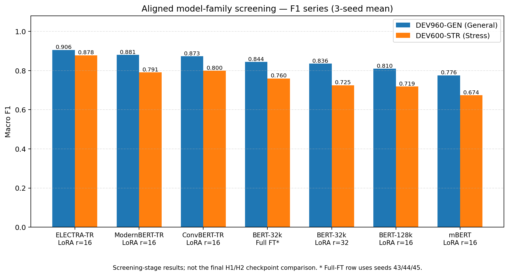
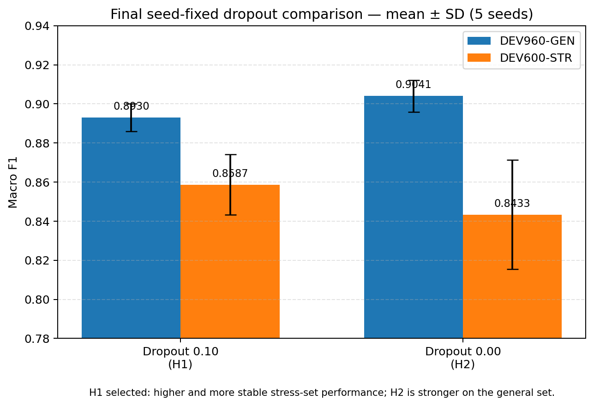
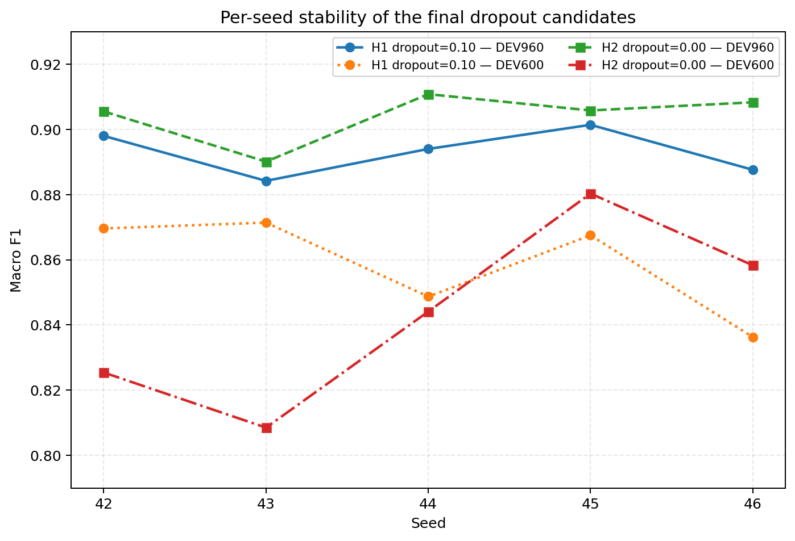
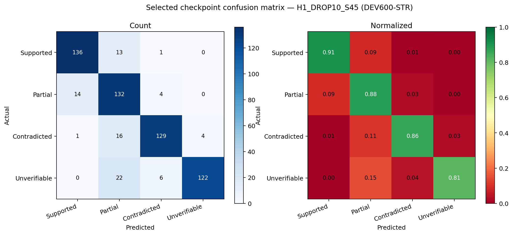
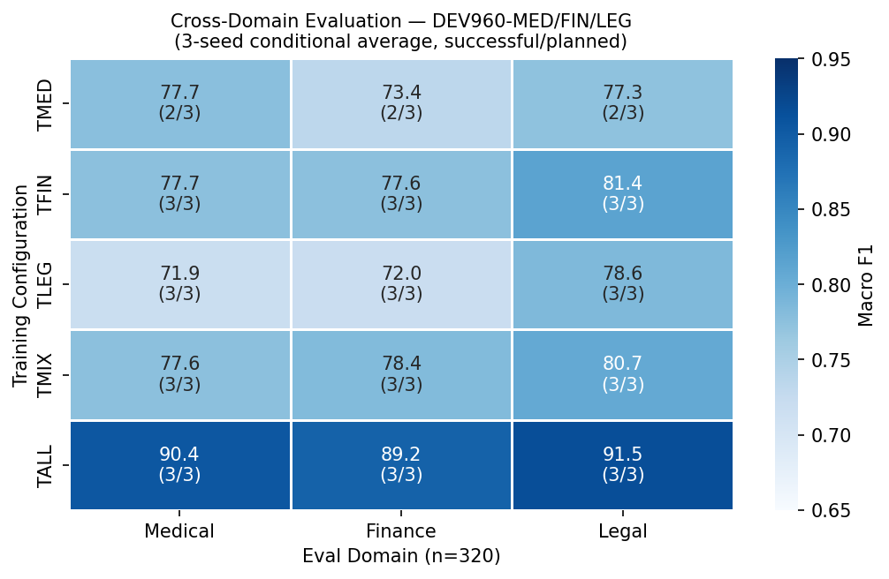
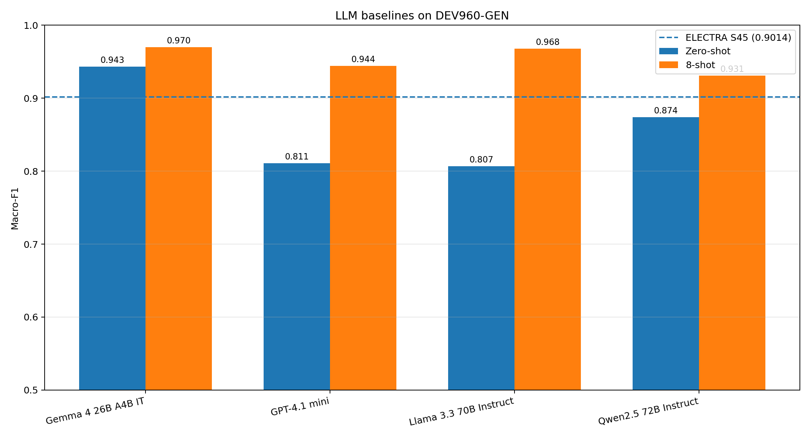
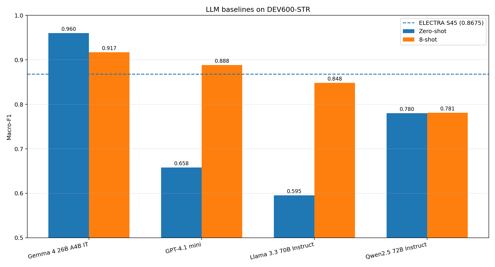

# TR-FactBench

**A Multi-Domain Benchmark for Source-Grounded Factuality Verification in Turkish**

[](LICENSE)
[](CITATION.cff)
[](requirements.txt)
[](final_config.lock.yaml)

**[Türkçe dokümantasyon](README_TR.md)**

> **Research preview.** The first independent blind-human pass is complete for both evaluation sets: DEV960 960/960 and Dev600 600/600. New preview evaluations should use `data/evaluation/preview_v0.1/dev_general.jsonl` and `data/evaluation/preview_v0.1/dev_stress.jsonl`. The second blind pass and adjudication are intentionally deferred to a later stable release; this does not block the single-annotator `v0.1.0-preview`, but the preview must not be described as a fully adjudicated gold benchmark.
>
> **Evaluation-version note.** Archived encoder and LLM scores remain tied to the original experimental files. The reviewed preview changes 2/960 DEV960 labels and 3/600 Dev600 labels, and includes one documented Dev600 claim correction. Training and API inference were not repeated for these limited revisions.
>
> **Selected model configuration:** `H1_DROP10_S45` — ELECTRA-TR, LoRA r=16 all-linear, dropout=0.10, seed=45, with Trainer `seed` and `data_seed` fixed. The configuration-level decision is based on the five-seed H1/H2 comparison; the selected checkpoint scores 0.9014 on DEV960 and 0.8675 on DEV600-STR. Configuration metadata is frozen in [`final_config.lock.yaml`](final_config.lock.yaml).

## Overview

TR-FactBench evaluates whether a Turkish claim is supported by a supplied source passage. It covers **finance, legal, and medical** content and uses four labels: `supported`, `partially_supported`, `contradicted`, and `unverifiable`. For definitions and decision rules see [Label definitions](#label-definitions) and the [Label Guide](docs/LABEL_GUIDE.md).

## Key results at a glance

TR-FactBench compares a locally deployable Turkish encoder with four general-purpose LLMs under zero-shot and 8-shot prompting. The table below reports the best prompting condition observed for each LLM alongside the selected ELECTRA checkpoint. Full per-condition results are in the [LLM baselines](#llm-baselines) section.

| System | DEV960-GEN Macro-F1 | DEV600-STR Macro-F1 |
|---|---:|---:|
| Gemma 4 26B MoE | **0.9699** (8-shot) | **0.9599** (zero-shot) |
| LLaMA 3.3 70B | 0.9678 (8-shot) | 0.8481 (8-shot) |
| GPT-4.1 mini | 0.9443 (8-shot) | 0.8885 (8-shot) |
| Qwen2.5 72B | 0.9310 (8-shot) | 0.7812 (8-shot) |
| **Selected ELECTRA-TR** (H1_DROP10_S45) | **0.9014** | **0.8675** |

Key observations: Gemma 4 26B achieves the strongest overall performance across both sets. The selected local ELECTRA checkpoint remains competitive on the stress set, outperforming the best Qwen and matching GPT-4.1 mini. Few-shot prompting is not uniformly beneficial — Gemma performs better zero-shot than 8-shot on DEV600-STR. ELECTRA provides local inference without per-example API calls.

The repository keeps the dataset, deterministic derived views, training and evaluation code, run-level predictions, validation reports, and canonical benchmark results together. Model weights are not stored in Git; the selected LoRA adapter will be published separately on Hugging Face after final stability checks.

## What is included

- **Primary dataset splits:** 6,360 examples in 1,590 context groups
- **Derived experiment views:** domain-specific, mixed-domain, and leave-one-domain-out splits
- **Training pipeline:** full fine-tuning, freezing, and LoRA configurations
- **Evaluation pipeline:** general, stress, and domain-specific evaluation sets
- **Run archive:** predictions, metrics, configuration records, and validation outputs
- **Canonical results:** one machine-readable metrics table rebuilt from run-level predictions

## Dataset overview

### Primary splits

| Split | File | Examples | Context groups | Per-class count |
|---|---|---:|---:|---:|
| Train | `data/primary/train.jsonl` | 4,800 | 1,200 | 1,200 |
| General development — archived experiment version | `data/evaluation/legacy_experiment_version/dev_general.jsonl` | 960 | 240 | 240 |
| Stress development — archived experiment version | `data/evaluation/legacy_experiment_version/dev_stress.jsonl` | 600 | 150 | 150 |
| **Total** |  | **6,360** | **1,590** |  |

For **new preview evaluations**, use the human-reviewed single-annotator files:

- `data/evaluation/preview_v0.1/dev_general.jsonl`
- `data/evaluation/preview_v0.1/dev_stress.jsonl`

The original `dev_general.jsonl` and `dev_stress.jsonl` files are retained unchanged because the archived model and LLM results were produced on those versions.

Each `context_id` is paired with exactly four claims: one `supported`, one `partially_supported`, one `contradicted`, and one `unverifiable` example. This grouped design keeps the source passage fixed while varying the factual relation between context and claim.

Files under `data/derived/` are deterministic subsets or combinations of the primary splits. They support domain-transfer and data-composition experiments but **do not add new examples** to the benchmark.

### Label definitions

| Label | Definition |
|---|---|
| `supported` | All atomic propositions in the claim are supported by the context. |
| `partially_supported` | A multi-atom claim has at least one supported atom and at least one unsupported or contradicted atom. |
| `contradicted` | No atom is supported; at least one atom explicitly conflicts with the context. |
| `unverifiable` | All atoms are absent from or underdetermined by the context; no explicit contradiction. |

For decision rules, boundary examples, and guidance on commonly confused pairs, see the [Label Guide](docs/LABEL_GUIDE.md).

### Record format

The primary JSONL files contain the core fields below. Release metadata such as split, dataset version, normalized annotation status, and source identifier is stored in `data/example_metadata.csv`.

```json
{
  "example_id": "fin_1200_supported",
  "context_id": "fin_1200",
  "domain": "finance",
  "context": "...",
  "question": "...",
  "claim": "...",
  "gold_label": "supported"
}
```

The field name `gold_label` is retained for pipeline compatibility. In the two provisional evaluation files, it records the completed first blind-human pass and `annotation_status=single_annotator_provisional`. Training labels remain construction-time candidate labels and are documented separately.

### Loading the dataset

No external dataset library is required:

```python
import json
from pathlib import Path


def read_jsonl(path: str):
    with Path(path).open("r", encoding="utf-8") as handle:
        return [json.loads(line) for line in handle if line.strip()]


train = read_jsonl("data/primary/train.jsonl")
print(len(train))  # 4800

first_context_id = train[0]["context_id"]
context_group = [row for row in train if row["context_id"] == first_context_id]
print([row["gold_label"] for row in context_group])
# ['supported', 'partially_supported', 'contradicted', 'unverifiable']
```

## How the dataset was built

The current release was prepared as a structured research dataset rather than collected as a naturally occurring four-label corpus.

1. **Context preparation:** Publicly available Turkish domain materials (medical, financial, legal) were collected, then rewritten, simplified, and controllably adapted into self-contained context groups. Materials are substantially transformed and not verbatim reproductions. Item-level source URLs were not preserved for train and general-development splits (see [Provenance](#annotation-and-provenance-status)); the stress split includes source URLs.
2. **Claim construction:** Each context group was paired with four claims designed to represent the four factuality relations while keeping the underlying passage fixed.
3. **LLM-assisted drafting:** Candidate questions and claims were produced with language-model assistance. The language model was used as a construction aid, not as an independent gold annotator.
4. **Automated validation:** Scripts checked JSONL structure, label and domain balance, context-group completeness, identifier uniqueness, split overlap, and deterministic regeneration of derived views.
5. **Selection and balancing:** The released primary splits were selected to maintain exact class balance and equal domain coverage. Automatic selection does not replace human semantic verification.
6. **Candidate-label refinement and blind review:** Dev600 completed the LLM-assisted human candidate-label quality-control pass and the first independent blind-human pass (600/600). DEV960 also completed its first independent blind-human pass (960/960). The second Dev600 pass is 80/600, while the second DEV960 pass and adjudication are deferred to the stable release. A separate 600-example, context-grouped train audit sample has been prepared for two blind annotators.

The construction scripts, manifests, checksums, and audit outputs are included so that later corrections can be tracked without silently replacing the original release.

## Annotation and provenance status

TR-FactBench v0.1.0-preview includes one completed independent blind annotation pass for both evaluation sets:

- DEV960: 960/960 examples reviewed
- Dev600: 600/600 examples reviewed

The human-reviewed evaluation files are available at:

- `data/evaluation/preview_v0.1/dev_general.jsonl`
- `data/evaluation/preview_v0.1/dev_stress.jsonl`

A second annotation pass and adjudication are planned for a future release.

## Benchmark protocol and current results

The single canonical result source is `results/csv/metrics_long_canonical.csv`. It is rebuilt from run-level `predictions_*.jsonl` files by `scripts/13_collect_results.py`.

Current repository state:

- 144 run directories and 144 validated runs, including the three-run ModernBERT series, H1 and historical G1 sentinels, and the five-run H2 comparison series
- 432 canonical `(run_id, eval_set)` rows
- 126 successful runs
- 17 historical class-collapse runs and 1 severely skewed run; all five seed-fixed H2/dropout=0.00 runs completed successfully
- **Reproducibility sentinel PASS:** `H1_SENTINEL_DROP10_S45_RERUN` — DEV960 Δ=+0.0013, DEV600 Δ=−0.0094 (within the predeclared 0.010 threshold)
- 24 domain-analysis runs evaluated on eight sets; the remaining 120 runs evaluated on the two main development sets

### Model-family screening

Three-seed screening results from the clean `F1_*` series:

| Model | Method | Trainable parameters | Trainable % | DEV960 Macro F1 | DEV600 Macro F1 | Seeds |
|---|---|---:|---:|---:|---:|---|
| **ELECTRA-TR** | LoRA r=16, q/k/v/dense/out_proj | 3,247,876 | 2.85% | **0.9058** | **0.8782** | 42/43/44 |
| ModernBERT-TR | LoRA r=16, all-linear | 3,406,852 | 2.23% | 0.8806 | 0.7911 | 42/43/44 |
| ConvBERT-TR | LoRA r=16, q/k/v/dense/out_proj | 3,026,692 | 2.74% | 0.8735 | 0.7995 | 42/43/44 |
| BERT-32k | Full fine-tuning | 110,620,420 | 100.00% | 0.8444 | 0.7598 | 43/44/45 |
| BERT-32k | LoRA r=32, q/k/v/dense | 5,360,644 | 4.62% | 0.8359 | 0.7255 | 42/43/44 |
| BERT-128k | LoRA r=16, q/k/v/dense | 2,681,860 | 1.43% | 0.8097 | 0.7187 | 42/43/44 |
| mBERT | LoRA r=16, q/k/v/dense | 2,681,860 | 1.49% | 0.7759 | 0.6739 | 42/43/44 |

BERT-32k full fine-tuning uses seeds 43/44/45, so this remains a model-selection screening table rather than a fully paired statistical comparison. The registered ModernBERT-TR series uses `all-linear` LoRA with dropout=0.10. Separate dropout=0.05 pilot attempts were reported to collapse but are not archived as canonical runs; no causal claim is made from those pilots.

Seven additional backbone families were tested at single-seed and did not advance: DistilBERT-TR (success but weak, DEV960=0.5497), RoBERTa-TR, XLM-RoBERTa, mDeBERTa-v3, TabiBERT, Turkish-Large-BERT, and BERT-128k uncased (B2 variant). Full observed outcomes under the tested configurations are listed in [`reports/MODEL_INVENTORY.md`](reports/MODEL_INVENTORY.md); the inventory avoids assigning untested root causes to failed runs.



### ELECTRA rank screening

Single-seed screening (`seed=42`, `alpha=2r`, all-linear):

| Rank | Trainable parameters | DEV960 | DEV600 |
|---:|---:|---:|---:|
| 4 | 1,257,220 | 0.8825 | 0.8530 |
| 8 | 1,920,772 | 0.9031 | 0.8307 |
| **16** | **3,247,876** | **0.9086** | **0.8545** |
| 32 | 5,902,084 | 0.8866 | 0.8525 |

This screening identifies r=16 as the current candidate. It is not a substitute for multi-seed validation.

### Adaptation-strategy screening (ELECTRA-TR)

Three adaptation strategies were evaluated for ELECTRA-TR. Partial encoder freezing
(Freeze-50) freezes the embedding layer and the lower six encoder layers (of twelve),
leaving the upper six layers and the classifier trainable.

| Strategy | Trainable params | Seeds | DEV960 F1 | DEV600 F1 |
|---|---:|---:|---:|---:|
| **LoRA r=16 all-linear** | **3,247,876** | **5** | **0.8930 ± 0.0071** | **0.8587 ± 0.0155** |
| Freeze-50 (lower 6 layers frozen) | 43,237,059 | 5 | 0.8734 ± 0.0067 | 0.8165 ± 0.0140 |
| Full fine-tuning | 110,620,420 | 3 | ~0.849 | ~0.793 |

Freeze-50 and full fine-tuning results come from an earlier experimental stage with slightly different hyperparameters and should be read as exploratory, not as a final controlled comparison. Complete freeze-ratio, alpha, and target-module ablation data are in [`reports/MODEL_INVENTORY.md`](reports/MODEL_INVENTORY.md).

### Final seed-fixed dropout comparison

H1 and H2 use the same current training pipeline, the same seeds (42–46), and explicit Trainer `seed`/`data_seed` values. The intended configuration difference is LoRA dropout.

| Series | Dropout | Seeds | DEV960 mean ± SD | DEV600 mean ± SD | Two-set mean | Decision |
|---|---:|---:|---:|---:|---:|---|
| **H1** | **0.10** | **42–46** | 0.8930 ± 0.0071 | **0.8587 ± 0.0155** | **0.8759** | **Selected** |
| H2 | 0.00 | 42–46 | **0.9041 ± 0.0081** | 0.8433 ± 0.0280 | 0.8737 | Not selected |

H2/dropout=0.00 is stronger on the general development set. H1/dropout=0.10 is stronger and more stable on the stress set and has a slightly higher two-set mean. The selection therefore remains H1/dropout=0.10. This decision is based on five-seed configuration-level behavior, not the strongest individual run. `H2_DROP0_S45` is a strong single checkpoint (0.9058/0.8803), but it does not replace that predeclared selection criterion.





The earlier G1 pipeline recorded a seed-46 class collapse for dropout=0.00. That failure was real in the archived G1 run, but it did **not** recur in any of the five seed-fixed H2 repetitions. G1 is retained as historical evidence rather than used to disqualify dropout=0.00. Its all-seed dropout=0.00 mean was 0.7443 ± 0.3603 on DEV960 and 0.7133 ± 0.3434 on DEV600 because the failed seed is included. The historical dropout=0.05 result remains a three-seed screening result only.

The selected checkpoint confusion matrices are generated from `H1_DROP10_S45`, not from the earlier F1 screening series.



### Domain analysis and exploratory ablations

Cross-domain transfer, leave-one-domain-out, data-composition, target-module, and historical stability results are documented in [`reports/BENCHMARK_RESULTS.md`](reports/BENCHMARK_RESULTS.md). Exploratory target-module results are kept out of the main README because the available runs are not yet a parameter-matched, multi-seed isolation of FFN effects.



## Repository layout

```text
tr-factbench/
├── data/
│   ├── primary/              # Published train and development splits
│   ├── derived/              # Deterministically generated experiment views
│   ├── example_metadata.csv
│   ├── sources_manifest.csv
│   └── checksums.sha256
├── runs/completed/           # Run-level configs, predictions, and metrics
├── results/
│   ├── csv/                  # Canonical run and metric tables
│   ├── tables/
│   ├── statistics/
│   ├── figures/
│   └── annotation/
├── reports/BENCHMARK_RESULTS.md
├── scripts/                  # Data, training, evaluation, and release scripts
├── src/                      # Training implementation
├── DATA_CARD.md
└── MODEL_CARD.md
```

## Quick start and reproducibility

```bash
git clone https://github.com/EngindalgaMaku/tr-factbench.git
cd tr-factbench
pip install -r requirements.txt

python scripts/00_preflight.py
python scripts/04_build_derived_splits.py
python scripts/14_validate_runs.py
python scripts/13_collect_results.py
python scripts/15_generate_tables.py
python scripts/16_generate_statistics.py
python scripts/18_generate_figures.py
python scripts/37_final_dropout_report.py
python scripts/35_generate_lock_yaml.py
python scripts/99_validate_release.py
```

Start a new ELECTRA run:

```bash
python scripts/10_run_experiment.py \
  --run_id MY_ELECTRA_TEST \
  --model_name dbmdz/electra-base-turkish-cased-discriminator \
  --method lora \
  --lora_r 16 \
  --lora_alpha 32 \
  --lora_target_modules all-linear \
  --lora_dropout 0.10 \
  --learning_rate 2e-4 \
  --seed 42
```

Model checkpoints are excluded from Git. Run-level predictions and metrics remain in the repository so that reported scores can be recomputed.

## Selected model

The selected TR-FactBench classifier is built on the Turkish ELECTRA discriminator
[`dbmdz/electra-base-turkish-cased-discriminator`](https://huggingface.co/dbmdz/electra-base-turkish-cased-discriminator).

| Component | Selected configuration |
|---|---|
| Base encoder | `dbmdz/electra-base-turkish-cased-discriminator` |
| Task | Four-class source-grounded factuality classification |
| Labels | `supported`, `partially_supported`, `contradicted`, `unverifiable` |
| Adaptation method | LoRA |
| LoRA target modules | All linear layers (`all-linear`) |
| LoRA rank / alpha | 16 / 32 |
| LoRA dropout | 0.10 |
| Maximum sequence length | 512 tokens |
| Learning rate | 2 × 10⁻⁴ |
| Batch size | 8 |
| Training epochs | 5 |
| Weight decay | 0.01 |
| Warmup ratio | 0.06 |
| Selected checkpoint | `H1_DROP10_S45` |
| Checkpoint seed | 45 |

The table below shows five-seed aggregate performance alongside the published checkpoint result.
The five-seed figure is the main scientific result; `H1_DROP10_S45` (seed 45) is the representative
checkpoint planned for release.

| Evaluation set | Five-seed Macro-F1 (mean ± std) | Selected checkpoint (S45) |
|---|---:|---:|
| DEV960-GEN | 0.8930 ± 0.0071 | **0.9014** |
| DEV600-STR | 0.8587 ± 0.0155 | **0.8675** |

Dropout 0.00 achieved higher average performance on DEV960-GEN, while dropout 0.10 produced
stronger and more stable results on DEV600-STR. The latter was therefore retained as the
selected release configuration.

The screening stage additionally covered ModernBERT-TR, ConvBERT-TR, BERT-32k, BERT-128k, mBERT, and full
fine-tuning baselines; complete run-level results are provided in [`reports/BENCHMARK_RESULTS.md`](reports/BENCHMARK_RESULTS.md).

See [`MODEL_CARD.md`](MODEL_CARD.md) for model-level documentation and
[`final_config.lock.yaml`](final_config.lock.yaml) for the frozen configuration and reproducibility metadata.

## LLM baselines

Four general-purpose LLMs were evaluated in two prompting conditions: instruction-only
zero-shot and fixed 8-shot. Each request contains exactly one context-claim pair. Gold
labels, candidate labels, example IDs, and context IDs are not exposed to the model.
Strict Macro-F1 counts missing or invalid outputs as errors.

### DEV960-GEN

| Model | Prompt | Macro-F1 | Accuracy | Coverage | Invalid/missing |
|---|---|---:|---:|---:|---:|
| Gemma 4 26B A4B IT | 8-shot | 0.9699 | 0.9698 | 1.0000 | 0 |
| Llama 3.3 70B Instruct | 8-shot | 0.9678 | 0.9677 | 1.0000 | 0 |
| GPT-4.1 mini | 8-shot | 0.9443 | 0.9437 | 1.0000 | 0 |
| Gemma 4 26B A4B IT | Zero-shot | 0.9433 | 0.9427 | 1.0000 | 0 |
| Qwen2.5 72B Instruct | 8-shot | 0.9310 | 0.9302 | 1.0000 | 0 |
| Qwen2.5 72B Instruct | Zero-shot | 0.8738 | 0.8750 | 1.0000 | 0 |
| GPT-4.1 mini | Zero-shot | 0.8106 | 0.8146 | 1.0000 | 0 |
| Llama 3.3 70B Instruct | Zero-shot | 0.8067 | 0.8052 | 1.0000 | 0 |

Selected ELECTRA checkpoint (`H1_DROP10_S45`): **0.9014 Macro-F1**.

### DEV600-STR

| Model | Prompt | Macro-F1 | Accuracy | Coverage | Invalid/missing |
|---|---|---:|---:|---:|---:|
| Gemma 4 26B A4B IT | Zero-shot | 0.9599 | 0.9600 | 1.0000 | 0 |
| Gemma 4 26B A4B IT | 8-shot | 0.9168 | 0.9183 | 1.0000 | 0 |
| GPT-4.1 mini | 8-shot | 0.8885 | 0.8883 | 1.0000 | 0 |
| Llama 3.3 70B Instruct | 8-shot | 0.8481 | 0.8567 | 1.0000 | 0 |
| Qwen2.5 72B Instruct | 8-shot | 0.7812 | 0.8017 | 0.9983 | 1 |
| Qwen2.5 72B Instruct | Zero-shot | 0.7800 | 0.7933 | 0.9983 | 1 |
| GPT-4.1 mini | Zero-shot | 0.6581 | 0.6850 | 1.0000 | 0 |
| Llama 3.3 70B Instruct | Zero-shot | 0.5953 | 0.6300 | 1.0000 | 0 |

Selected ELECTRA checkpoint (`H1_DROP10_S45`): **0.8675 Macro-F1**.

### Interpretation

- Few-shot prompting strongly improves GPT-4.1 mini and Llama 3.3 70B on both sets.
- Qwen2.5 72B improves on DEV960 but changes little on DEV600; one output is invalid or
  missing in each DEV600 prompting condition.
- Gemma is strongest overall in these runs. On DEV600 its zero-shot score exceeds its
  8-shot score, so demonstrations are not uniformly beneficial.
- The selected local ELECTRA checkpoint remains competitive with several API baselines,
  especially on DEV600, while avoiding per-example API inference.

### Protocol notes

- The exact requested and resolved model IDs are preserved in each run manifest and in
  `results/llm_baselines/experiment_matrix.csv`.
- DEV600 Gemma runs requested the OpenRouter `:free` route, whereas DEV960 requested the
  standard model route. These are reported transparently rather than treated as an
  identical provider-routing condition.
- All few-shot runs used the same fixed demonstration file with SHA-256
  `2b30bc4360ea5922d3b969a1fcc65528cf10df481afecdd7ace968142d78e8ba`.
- Archived scores were produced on the original pre-review evaluation files. The single-annotator preview changes 2/960 DEV960 labels and 3/600 Dev600 labels, with one additional Dev600 claim correction. Reported values may therefore shift slightly on the reviewed preview files; API calls and model training were not repeated for these limited revisions.

Machine-readable results are available in `results/tables/table_I_llm_baselines.csv` and
`results/llm_baselines/leaderboard.csv`.





## Model release

A Hugging Face LoRA-adapter release is planned under:

`EngindalgaMaku/tr-factbench-electra-lora`

**Selected checkpoint configuration:** `H1_DROP10_S45` (ELECTRA-TR, LoRA r=16 all-linear, dropout=0.10, seed=45, seed+data_seed fix applied). DEV960=0.9014, DEV600-STR=0.8675. Reproducibility sentinel `H1_SENTINEL_DROP10_S45_RERUN` PASS (Δ < 0.010). The adapter can accompany the research preview after a clean load/inference test. Completion of the second blind pass and adjudication remains a requirement for the later stable release.

## Release roadmap

Before a stable `v1.0.0` release, the project plans to complete:

- ~~aligned multi-seed model comparison~~ ✓ completed
- ~~final dropout comparison~~ ✓ completed (H1/dropout=0.10 vs H2/dropout=0.00, five seeds each; H1 selected)
- ~~reproducibility rerun of the selected configuration~~ ✓ completed (sentinel PASS)
- completion of the second blind-human pass and adjudication for both evaluation sets
- completion of the 600-example, context-grouped train quality audit with two blind annotators
- clean-environment adapter loading/inference verification
- Hugging Face publication of the selected LoRA adapter

## Licensing and citation

- Code: MIT (`LICENSE`)
- Project-created claims, questions, labels, and metadata: CC BY 4.0 (`data/DATA_LICENSE.md`)
- Context passages: source-dependent rights (`data/NOTICE.md`, `data/sources_manifest.csv`)

Citation metadata is provided in [`CITATION.cff`](CITATION.cff).
