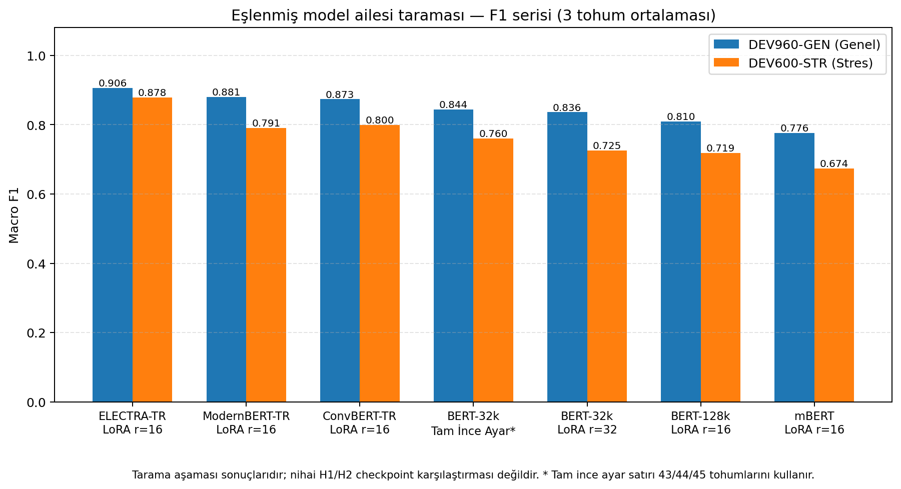
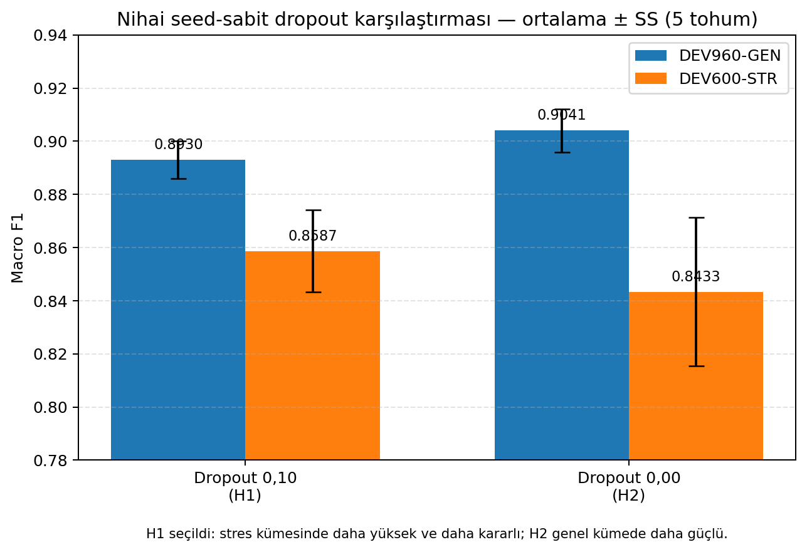
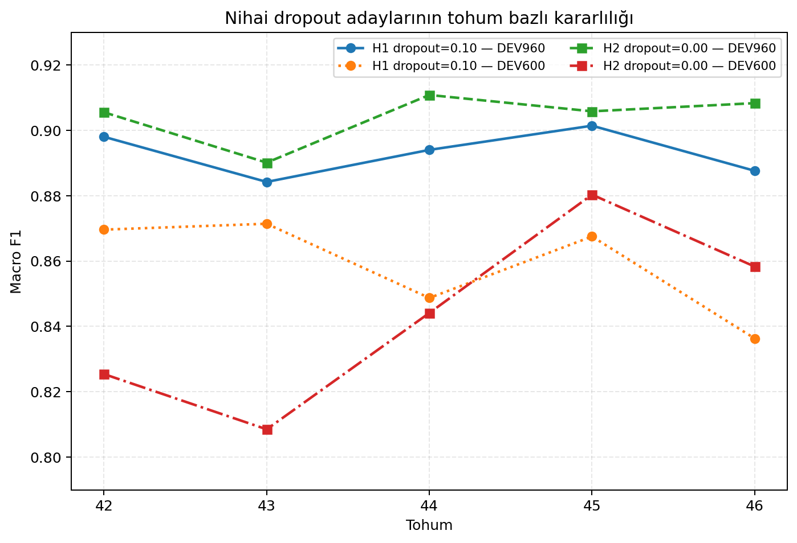
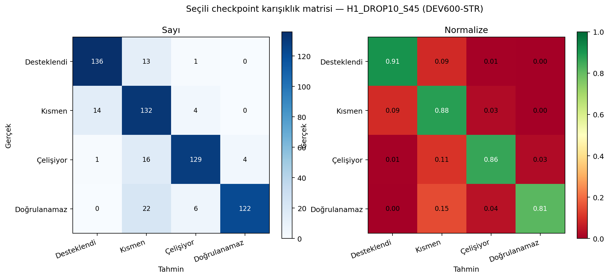
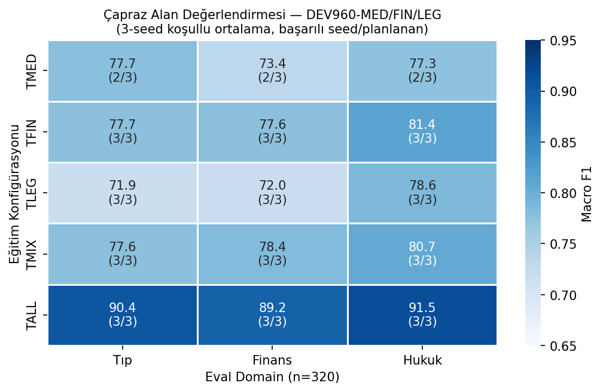
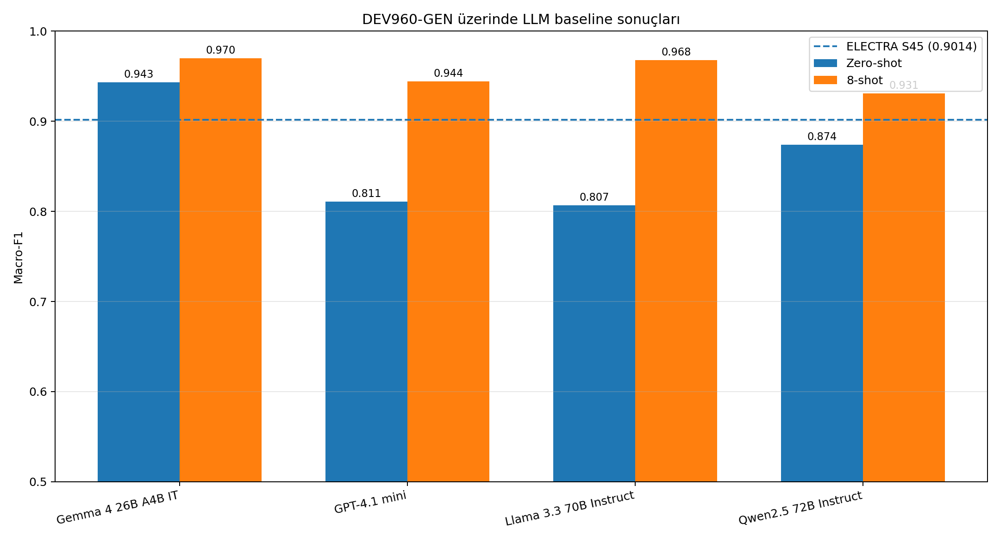
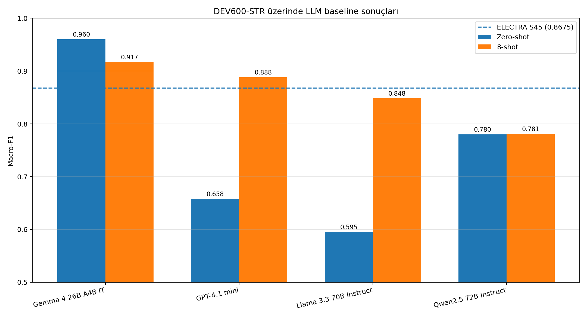

# TR-FactBench

**Türkçe Kaynak-Temelli Olgusal Doğrulama İçin Çok Alanlı Karşılaştırma Veri Seti**

[](LICENSE)
[](CITATION.cff)
[](requirements.txt)
[](final_config.lock.yaml)

**[English documentation](README.md)**

> **Araştırma ön sürümü.** Birinci kör insan incelemesi tamamlandı: DEV960 960/960 ve Dev600 600/600. Yeni değerlendirmeler için `data/evaluation/preview_v0.1/` kullanınız. İkinci geçiş ve uzlaştırma gelecekteki bir sürüm için planlanmıştır.
>
> **Seçilen model:** `H1_DROP10_S45` — ELECTRA-TR, LoRA r=16, dropout=0,10, tohum=45. DEV960=0,9014, DEV600=0,8675. Bkz. [`final_config.lock.yaml`](final_config.lock.yaml).

## Genel bakış

TR-FactBench, Türkçe bir iddianın verilen kaynak bağlamıyla ne ölçüde doğrulanabildiğini değerlendiren dört sınıflı bir karşılaştırma veri setidir. **Finans, hukuk ve tıp** alanlarını kapsar. Dört etiket sınıfı: `supported`, `partially_supported`, `contradicted`, `unverifiable`. Tanımlar ve karar kuralları için [Etiket tanımları](#etiket-tanımları) ve [Etiketleme Kılavuzu](docs/LABEL_GUIDE_TR.md) belgelerine bakınız.

Depoda veri seti, deterministik türev görünümler, eğitim ve değerlendirme kodları, koşu bazlı tahminler, doğrulama raporları ve kanonik benchmark sonuçları birlikte tutulur. Model ağırlıkları Git deposunda bulunmaz. Seçilen LoRA adaptörü, nihai kararlılık kontrollerinden sonra Hugging Face üzerinde ayrıca yayımlanacaktır.

## Depoda neler var?

- **Ana veri bölümleri:** 1.590 bağlam grubunda 6.360 örnek
- **Türev deney görünümleri:** alan özelinde, karma alanlı ve bir alanı dışarıda bırakan bölümler
- **Eğitim hattı:** tam ince ayar, katman dondurma ve LoRA yapılandırmaları
- **Değerlendirme hattı:** genel, stres ve alan özelinde değerlendirme kümeleri
- **Koşu arşivi:** tahminler, metrikler, yapılandırma kayıtları ve doğrulama çıktıları
- **Kanonik sonuçlar:** koşu bazlı tahminlerden yeniden oluşturulan tek makine-okunur metrik tablosu

## Veri setine genel bakış

### Veri bölümleri ve değerlendirme sürümleri

| Bölüm | Dosya | Örnek | Bağlam grubu | Sınıf başına örnek |
|---|---|---:|---:|---:|
| Eğitim | `data/primary/train.jsonl` | 4.800 | 1.200 | 1.200 |
| Genel geliştirme — arşiv deney sürümü | `data/evaluation/legacy_experiment_version/dev_general.jsonl` | 960 | 240 | 240 |
| Stres geliştirme — arşiv deney sürümü | `data/evaluation/legacy_experiment_version/dev_stress.jsonl` | 600 | 150 | 150 |
| **Toplam** |  | **6.360** | **1.590** |  |

**Yeni preview değerlendirmeleri** için insan tarafından gözden geçirilmiş dosyalar kullanılmalıdır:

- `data/evaluation/preview_v0.1/dev_general.jsonl`
- `data/evaluation/preview_v0.1/dev_stress.jsonl`

Alan bazlı preview görünümleri `data/evaluation/preview_v0.1/domain/` altında yer alır.

Arşiv sonuçlarının kullandığı dosyalar `data/evaluation/legacy_experiment_version/` altında byte düzeyinde değiştirilmeden korunur. Yeni değerlendirmelerde aynı adlı dosyaların `preview_v0.1/` sürümü kullanılmalıdır.

Her `context_id` tam olarak dört iddiayla eşleştirilmiştir: bir `supported`, bir `partially_supported`, bir `contradicted` ve bir `unverifiable` örneği. Bu gruplu tasarımda kaynak pasaj sabit tutulurken bağlam ile iddia arasındaki olgusal ilişki değiştirilir.

`data/derived/` altındaki dosyalar ana bölümlerin deterministik alt kümeleri veya birleşimleridir. Alan aktarımı ve veri bileşimi deneylerinde kullanılırlar; benchmarka **yeni örnek eklemezler**.

### Etiket tanımları

| Etiket | Kısa tanım |
|---|---|
| `supported` | İddiadaki bütün doğrulanabilir önermeler bağlam tarafından desteklenir. |
| `partially_supported` | Çok önermeli iddianın en az bir bölümü desteklenir, en az bir bölümü desteklenmez veya çelişir. |
| `contradicted` | İddia bağlamdaki açık bilgiyle çelişir ve desteklenen bir ana önerme içermez. |
| `unverifiable` | İddiayı destekleyen veya çürüten yeterli bilgi bağlamda bulunmaz. |

Karar kuralları, sınır örnekleri ve sıkça karıştırılan çiftlere (`contradicted` ile `unverifiable`, `partially_supported` ile `unverifiable`) ilişkin kılavuz için [Etiketleme Kılavuzu](docs/LABEL_GUIDE_TR.md) belgesine bakınız.

### Kayıt biçimi

Ana JSONL dosyalarında aşağıdaki temel alanlar bulunur. `data/example_metadata.csv` arşiv deney sürümünü açıklar. Preview değerlendirme dosyaları inceleme metadatasını doğrudan taşır; Dev600 eski ve yeni kimlik eşlemesi `data/manifests/dev600_legacy_to_preview_id_map.csv` dosyasındadır.

```json
{
  "example_id": "fin_1200_supported",
  "context_id": "fin_1200",
  "domain": "finance",
  "context": "...",
  "question": "...",
  "claim": "...",
  "gold_label": "supported"
}
```

`gold_label` alan adı eğitim hattıyla uyumluluk için korunmuştur. İki geçici değerlendirme dosyasında bu alan tamamlanan birinci kör insan geçişini gösterir ve `annotation_status=single_annotator_provisional` olarak işaretlenir. Eğitim etiketleri ise üretim aşamasındaki aday etiketlerdir ve ayrıca belgelenir.

### Veri setini yükleme

Haricî bir veri seti kütüphanesi kullanmak zorunlu değildir:

```python
import json
from pathlib import Path


def read_jsonl(path: str):
    with Path(path).open("r", encoding="utf-8") as handle:
        return [json.loads(line) for line in handle if line.strip()]


train = read_jsonl("data/primary/train.jsonl")
print(len(train))  # 4800

first_context_id = train[0]["context_id"]
context_group = [row for row in train if row["context_id"] == first_context_id]
print([row["gold_label"] for row in context_group])
# ['supported', 'partially_supported', 'contradicted', 'unverifiable']
```

## Veri seti nasıl oluşturuldu?

Bu sürüm, doğal biçimde oluşmuş dört etiketli bir derlemden doğrudan toplanmak yerine yapılandırılmış bir araştırma veri seti olarak hazırlanmıştır.

1. **Bağlamların hazırlanması:** Tıp, finans ve hukuk alanlarındaki kamuya açık Türkçe içeriklerden yararlanılmış; pasajlar kaynak-bağımlı doğrulama görevi için yeniden yazılmış, sadeleştirilmiş ve kontrollü biçimde uyarlanmıştır. Stres kümesinde örnek düzeyinde kaynak URL'leri bulunmaktadır; eğitim ve genel geliştirme kümelerinde her bağlam için URL saklanmamıştır.
2. **İddiaların oluşturulması:** Her bağlam grubu, kaynak pasaj sabit kalacak biçimde dört olgusal ilişkiyi temsil eden dört iddiayla eşleştirilmiştir.
3. **LLM destekli taslak üretimi:** Aday soru ve iddiaların hazırlanmasında dil modellerinden destek alınmıştır. Dil modeli, bağımsız altın standart anotör olarak değil, veri oluşturma aracı olarak kullanılmıştır.
4. **Otomatik doğrulama:** Betikler JSONL yapısını, etiket ve alan dengesini, bağlam gruplarının eksiksizliğini, kimliklerin benzersizliğini, bölümler arası çakışmaları ve türev görünümlerin deterministik biçimde yeniden üretilebilmesini denetlemiştir.
5. **Seçim ve dengeleme:** Yayımlanan ana bölümler tam sınıf dengesi ve eşit alan dağılımı korunacak biçimde seçilmiştir. Otomatik seçim, insan tarafından yapılan anlamsal doğrulamanın yerine geçmez.
6. **Aday etiket iyileştirme ve kör inceleme:** Dev600 üzerinde insan denetimli aday etiket kalite kontrolü ve birinci bağımsız kör insan geçişi tamamlanmıştır (600/600). DEV960'ın birinci bağımsız kör insan geçişi de tamamlanmıştır (960/960). Dev600 ikinci geçişi 80/600 düzeyindedir; DEV960 ikinci geçişi ve uzlaştırma kararlı sürüme bırakılmıştır. Eğitim kümesi için ayrıca 150 bağlamdan oluşan 600 örneklik çift-kör kalite örneklemi hazırlanmıştır.

Oluşturma betikleri, manifestler, sağlama toplamları ve denetim çıktıları depoda tutulur. Böylece daha sonraki etiket düzeltmeleri, önceki sürüm sessizce değiştirilmeden izlenebilir.

## Anotasyon ve kaynak durumu

TR-FactBench v0.1.0-preview, her iki değerlendirme kümesi için tamamlanmış bağımsız kör insan inceleme geçişi içerir:

- DEV960: 960/960 örnek incelendi
- Dev600: 600/600 örnek incelendi

İnsan tarafından gözden geçirilmiş değerlendirme dosyaları:

- `data/evaluation/preview_v0.1/dev_general.jsonl`
- `data/evaluation/preview_v0.1/dev_stress.jsonl`

İkinci anotasyon geçişi ve uzlaştırma gelecekteki bir sürümde planlanmıştır.

`data/sources_manifest.csv` her bağlam grubu için bir satır içerir. Stres kümesinde kaynak URL'leri mevcuttur. Eğitim ve genel geliştirme verisindeki bağlamlar, kamuya açık tıp, finans ve hukuk alan kaynaklarından yeniden yazılarak ve uyarlanarak oluşturulmuştur; bu nedenle her örnek için ayrı URL saklanmamıştır (manifest'te `provenance_status=source_adapted_no_item_url` olarak işaretlidir). Etiketler, iddianın sağlanan bağlam tarafından desteklenme durumunu ifade eder — dış dünyadaki genel doğruluğu değil. Yeniden dağıtım veya ticari kullanım öncesinde `data/DATA_LICENSE.md` ve `data/NOTICE.md` incelenmelidir.

## Deney protokolü ve mevcut sonuçlar

Bu bölümde raporlanan skorlar, `data/evaluation/legacy_experiment_version/` altında korunan insan incelemesi öncesi deney dosyalarına aittir.

Tek kanonik sonuç kaynağı `results/csv/metrics_long_canonical.csv` dosyasıdır. Dosya, `scripts/13_collect_results.py` tarafından koşu bazlı `predictions_*.jsonl` dosyalarından yeniden oluşturulur.

Deponun mevcut durumu:

- Üç koşuluk ModernBERT serisi, H1 ve tarihsel G1 sentinel koşulları ile beş koşuluk H2 serisi dâhil 144 koşu klasörü ve 144 doğrulanmış koşu
- 432 kanonik `(run_id, eval_set)` satırı
- 126 başarılı koşu
- Tarihsel arşivde 17 sınıf çöküşü ve 1 aşırı çarpık tahmin koşusu; seed-sabit H2/dropout=0,00 serisindeki beş koşunun tamamı başarılıdır
- **Yeniden üretilebilirlik sentinel GEÇTİ:** `H1_SENTINEL_DROP10_S45_RERUN` — DEV960 Δ=+0,0013, DEV600 Δ=−0,0094 (önceden belirlenen 0,010 eşiği içinde)
- 24 alan analizi koşusu sekiz değerlendirme kümesinde, kalan 120 koşu iki ana geliştirme kümesinde değerlendirilmiştir

### Model ailesi taraması

Temiz `F1_*` serisindeki üç tohumlu tarama sonuçları:

| Model | Yöntem | Eğitilebilir parametre | Oran | DEV960 Macro F1 | DEV600 Macro F1 | Tohumlar |
|---|---|---:|---:|---:|---:|---|
| **ELECTRA-TR** | LoRA r=16, all-linear | 3.247.876 | %2,85 | **0,9058** | **0,8782** | 42/43/44 |
| ModernBERT-TR | LoRA r=16, all-linear | 3.406.852 | %2,23 | 0,8806 | 0,7911 | 42/43/44 |
| ConvBERT-TR | LoRA r=16, all-linear | 3.026.692 | %2,74 | 0,8735 | 0,7995 | 42/43/44 |
| BERT-32k | Tam ince ayar | 110.620.420 | %100,00 | 0,8444 | 0,7598 | 43/44/45 |
| BERT-32k | LoRA r=32, all-linear | 5.360.644 | %4,62 | 0,8359 | 0,7255 | 42/43/44 |
| BERT-128k | LoRA r=16, all-linear | 2.681.860 | %1,43 | 0,8097 | 0,7187 | 42/43/44 |
| mBERT | LoRA r=16, all-linear | 2.681.860 | %1,49 | 0,7759 | 0,6739 | 42/43/44 |

BERT-32k tam ince ayar satırı 43/44/45 tohumlarını kullandığı için tablo tam eşleştirilmiş bir istatistiksel karşılaştırma değil, model seçimi taramasıdır. Kayıtlı ModernBERT-TR serisi dropout=0,10 kullanır. Dropout=0,05 ile yapılan ve arşivlenmeyen pilot denemelerde çökme gözlendiği bildirilmiştir; bu pilotlardan nedensel bir sonuç çıkarılmamıştır.



### ELECTRA rank taraması

Tek tohumlu tarama (`seed=42`, `alpha=2r`, all-linear):

| Rank | Eğitilebilir parametre | DEV960 | DEV600 |
|---:|---:|---:|---:|
| 4 | 1.257.220 | 0,8825 | 0,8530 |
| 8 | 1.920.772 | 0,9031 | 0,8307 |
| **16** | **3.247.876** | **0,9086** | **0,8545** |
| 32 | 5.902.084 | 0,8866 | 0,8525 |

Bu taramada r=16 mevcut adaydır. Tek tohumlu sonuç, çoklu tohum doğrulamasının yerine geçmez.

### Nihai seed-sabit dropout karşılaştırması

H1 ve H2 aynı güncel eğitim hattını, aynı tohumları (42–46) ve açıkça sabitlenmiş Trainer `seed`/`data_seed` değerlerini kullanır. Amaçlanan yapılandırma farkı yalnız LoRA dropout değeridir.

| Seri | Dropout | Tohumlar | DEV960 ort. ± SS | DEV600 ort. ± SS | İki-küme ort. | Karar |
|---|---:|---:|---:|---:|---:|---|
| **H1** | **0,10** | **42–46** | 0,8930 ± 0,0071 | **0,8587 ± 0,0155** | **0,8759** | **Seçildi** |
| H2 | 0,00 | 42–46 | **0,9041 ± 0,0081** | 0,8433 ± 0,0280 | 0,8737 | Seçilmedi |

H2/dropout=0,00 genel geliştirme kümesinde daha güçlüdür. H1/dropout=0,10 ise stres kümesinde daha yüksek ve daha kararlı sonuç verir, ayrıca iki kümenin birleşik ortalamasında küçük bir üstünlüğe sahiptir. Bu nedenle seçili yapılandırma H1/dropout=0,10 olarak korunmuştur. Karar en iyi tek koşula değil, beş tohumlu yapılandırma davranışına dayanır. `H2_DROP0_S45` güçlü bir tekil checkpointtir (0,9058/0,8803), ancak bu seçim ölçütünün yerine geçmez.





Eski G1 hattında dropout=0,00 için seed 46'da gerçek bir sınıf çöküşü kaydedilmiştir. Ancak bu durum seed-sabit H2 serisindeki beş tekrarın hiçbirinde yeniden ortaya çıkmamıştır. Bu nedenle G1 sonucu tarihsel kanıt olarak korunur, dropout=0,00'ı diskalifiye etmek için kullanılmaz. Başarısız tohum dâhil G1 dropout=0,00 ortalaması DEV960'ta 0,7443 ± 0,3603, DEV600'de 0,7133 ± 0,3434'tür. Tarihsel dropout=0,05 sonucu yalnız üç tohumlu bir taramadır.

Seçili checkpoint karışıklık matrisleri eski F1 tarama serisinden değil, `H1_DROP10_S45` koşusundan üretilmiştir.



### Bağlam bağımlılığı ablasyonu (yalnızca çıkarım)

Sınıflandırıcının yalnızca iddia düzeyindeki yüzey ipuçlarına değil, sunulan kanıta dayanıp dayanmadığını ölçmek için aynı eğitilmiş ELECTRA checkpointi insan gözden geçirmeli preview kümelerinde üç çıkarım koşuluyla değerlendirildi. Koşullar arasında yeniden eğitim yapılmadı; yalnızca modele verilen giriş değiştirildi.

| Giriş koşulu | DEV960-GEN Macro-F1 | DEV600-STR Macro-F1 |
|---|---:|---:|
| **Tam giriş**: özgün bağlam + soru + iddia | **0,8994** | **0,8686** |
| Bağlamsız giriş: soru + iddia (bağlam boş; özgün soru + iddia korunur) | 0,4043 | 0,3858 |
| Karıştırılmış bağlam: farklı bağlam; özgün soru + iddia korunur | 0,3740 | 0,3508 |

Bağlamın tamamen kaldırılması (soru ve iddia sabit tutularak) Macro-F1 değerini DEV960-GEN'de 0,4951, DEV600-STR'de 0,4828 puan düşürmektedir. Bağlamın ilgisiz ve karıştırılmış bir bağlamla değiştirilmesi ise sırasıyla 0,5254 ve 0,5177 puanlık daha büyük bir düşüşe yol açmaktadır. Bu sonuç, bağlamdan bağımsız soru–iddia ipuçlarının tam girişte elde edilen performansı açıklamak için yetersiz olduğunu ve modelin sağlanan kanıt metnine gerçekten dayandığını göstermektedir.

Karıştırılmış koşulda sabit `seed=0` kullanılmış, her değerlendirme kümesindeki bağlamlar küme genelinde karıştırılmış ve bir örneğin kendi bağlamını yeniden alması engellenmiştir. Karıştırma aynı alanla sınırlandırılmamıştır. Makinece okunabilir ve makalede kullanılabilir tablolar [`table_J_context_dependence_ablation.csv`](results/tables/table_J_context_dependence_ablation.csv) ile [`table_J_context_dependence_ablation.md`](results/tables/table_J_context_dependence_ablation.md) dosyalarındadır. Bu tanısal sonuçlar yeni eğitim koşulları olmadığı için 144 koşuluk kanonik eğitim arşivinden ayrı tutulmuştur.

### Alan analizi ve keşifsel ablasyonlar

Alanlar arası aktarım, bir alanı dışarıda bırakan eğitim, veri bileşimi, hedef modül ve tarihsel kararlılık sonuçları [`reports/BENCHMARK_RESULTS.md`](reports/BENCHMARK_RESULTS.md) dosyasında sunulur. Hedef modül sonuçları ana README dışında tutulmuştur; çünkü mevcut koşular FFN etkisini tek başına ayıran, parametre-eşlemeli ve çoklu tohumlu bir deney değildir.



## Depo yapısı

```text
tr-factbench/
├── data/
│   ├── primary/              # Yayımlanan eğitim ve geliştirme bölümleri
│   ├── derived/              # Deterministik deney görünümleri
│   ├── example_metadata.csv
│   ├── sources_manifest.csv
│   └── checksums.sha256
├── runs/completed/           # Koşu bazlı ayarlar, tahminler ve metrikler
├── results/
│   ├── csv/                  # Kanonik koşu ve metrik tabloları
│   ├── tables/
│   ├── statistics/
│   ├── figures/
│   └── annotation/
├── reports/BENCHMARK_RESULTS.md
├── scripts/                  # Veri, eğitim, değerlendirme ve yayın betikleri
├── src/                      # Eğitim uygulaması
├── DATA_CARD.md
└── MODEL_CARD.md
```

## Hızlı başlangıç ve yeniden üretim

```bash
git clone https://github.com/EngindalgaMaku/tr-factbench.git
cd tr-factbench
pip install -r requirements.txt

python scripts/00_preflight.py
python scripts/04_build_derived_splits.py
python scripts/14_validate_runs.py
python scripts/13_collect_results.py
python scripts/15_generate_tables.py
python scripts/16_generate_statistics.py
python scripts/18_generate_figures.py
python scripts/37_final_dropout_report.py
python scripts/35_generate_lock_yaml.py
python scripts/99_validate_release.py
```

Yeni bir ELECTRA koşusu başlatmak için:

```bash
python scripts/10_run_experiment.py \
  --run_id MY_ELECTRA_TEST \
  --model_name dbmdz/electra-base-turkish-cased-discriminator \
  --method lora \
  --lora_r 16 \
  --lora_alpha 32 \
  --lora_target_modules all-linear \
  --lora_dropout 0.10 \
  --learning_rate 2e-4 \
  --seed 42
```

Model checkpoint’leri Git deposuna eklenmemiştir. Raporlanan skorların yeniden hesaplanabilmesi için koşu bazlı tahminler ve metrikler depoda tutulur.

## Seçilen model

Seçilen TR-FactBench sınıflandırıcısı, Türkçe ELECTRA diskriminatör modeli
[`dbmdz/electra-base-turkish-cased-discriminator`](https://huggingface.co/dbmdz/electra-base-turkish-cased-discriminator)
üzerine LoRA ile uyarlanmıştır.

| Bileşen | Seçilen yapılandırma |
|---|---|
| Temel kodlayıcı | `dbmdz/electra-base-turkish-cased-discriminator` |
| Görev | Dört sınıflı kaynak-tabanlı olgusallık sınıflandırması |
| Etiketler | `supported`, `partially_supported`, `contradicted`, `unverifiable` |
| Uyarlama yöntemi | LoRA |
| LoRA hedef modüller | Tüm doğrusal katmanlar (`all-linear`) |
| LoRA rank / alpha | 16 / 32 |
| LoRA dropout | 0.10 |
| Maksimum dizi uzunluğu | 512 token |
| Öğrenme oranı | 2 × 10⁻⁴ |
| Parti boyutu | 8 |
| Eğitim epoch sayısı | 5 |
| Ağırlık azalması | 0.01 |
| Isınma oranı | 0.06 |
| Seçilen checkpoint | `H1_DROP10_S45` |
| Checkpoint seed'i | 45 |

Aşağıdaki tablo beş-seed toplamını ve yayımlanacak checkpoint sonucunu ayrı olarak göstermektedir.
Beş-seed ortalaması ana bilimsel sonuçtur; `H1_DROP10_S45` (seed 45) ise yayımlanması planlanan
temsilî checkpoint'tir.

| Değerlendirme seti | Beş-seed Macro-F1 (ortalama ± std) | Seçilen checkpoint (S45) |
|---|---:|---:|
| DEV960-GEN | 0,8930 ± 0,0071 | **0,9014** |
| DEV600-STR | 0,8587 ± 0,0155 | **0,8675** |

Yukarıdaki tüm değerler özgün deney değerlendirme dosyaları (legacy) üzerinden hesaplanmıştır. 5 etiket düzeltmesi ve 1 claim düzeltmesine karşı sağlamlığı değerlendirmek amacıyla **aynı yapılandırma ve tohum** (H1_DROP10_S45) kullanılarak yeniden eğitim yapılmış ve insan gözden geçirmeli preview dosyaları (`data/evaluation/preview_v0.1/`) üzerinde değerlendirilmiştir. Not: Bu, aynı checkpoint üzerinden inference değil, yeniden bir eğitim koşusudur; dolayısıyla performans farkı hem etiket değişikliklerini hem de yeni eğitim koşusundan kaynaklanan doğal varyasyonu yansıtmaktadır.

| Değerlendirme seti | Legacy Macro-F1 | Preview Macro-F1 | Δ |
|---|---:|---:|---:|
| DEV960-GEN | 0,9014 | **0,8965** | −0,0049 |
| DEV600-STR | 0,8675 | **0,8522** | −0,0153 |

Yeniden eğitim koşusu `runs/preview_evaluations/H1_DROP10_S45_PREVIEW` altında arşivlenmiştir. Küçük performans farkı sınırlı anotasyon değişiklikleriyle tutarlıdır; ancak farkın yalnızca bu değişikliklerden kaynaklandığı söylenemez.

Dropout 0.00, DEV960-GEN üzerinde daha yüksek ortalama performans sağlarken, dropout 0.10
DEV600-STR üzerinde daha güçlü ve kararlı sonuçlar üretmiştir. Bu nedenle dropout 0.10
seçilmiş yayın yapılandırması olarak belirlenmiştir.

Tarama aşamasında ayrıca ModernBERT-TR, ConvBERT-TR, BERT-32k, BERT-128k, mBERT ve tam ince-ayar
temel noktaları değerlendirilmiştir; koşu düzeyindeki tam sonuçlar [`reports/BENCHMARK_RESULTS.md`](reports/BENCHMARK_RESULTS.md) dosyasında yer almaktadır.

Model düzeyindeki belgeler için [`MODEL_CARD.md`](MODEL_CARD.md) dosyasına,
dondurulmuş yapılandırma ve yeniden üretim meta verisi için
[`final_config.lock.yaml`](final_config.lock.yaml) dosyasına bakınız.

## LLM baseline sonuçları

Dört genel amaçlı LLM, yalnız yönerge içeren zero-shot ve sabit 8-shot olmak üzere iki
prompt koşulunda değerlendirilmiştir. Her istek yalnızca tek bir bağlam-iddia çifti içerir.
Gold etiket, aday etiket, örnek kimliği ve bağlam kimliği modele gösterilmez. Strict
Macro-F1 hesabında eksik veya geçersiz çıktılar hata kabul edilir.

### DEV960-GEN

| Model | Prompt | Macro-F1 | Accuracy | Coverage | Invalid/missing |
|---|---|---:|---:|---:|---:|
| Gemma 4 26B A4B IT | 8-shot | 0.9699 | 0.9698 | 1.0000 | 0 |
| Llama 3.3 70B Instruct | 8-shot | 0.9678 | 0.9677 | 1.0000 | 0 |
| GPT-4.1 mini | 8-shot | 0.9443 | 0.9437 | 1.0000 | 0 |
| Gemma 4 26B A4B IT | Zero-shot | 0.9433 | 0.9427 | 1.0000 | 0 |
| Qwen2.5 72B Instruct | 8-shot | 0.9310 | 0.9302 | 1.0000 | 0 |
| Qwen2.5 72B Instruct | Zero-shot | 0.8738 | 0.8750 | 1.0000 | 0 |
| GPT-4.1 mini | Zero-shot | 0.8106 | 0.8146 | 1.0000 | 0 |
| Llama 3.3 70B Instruct | Zero-shot | 0.8067 | 0.8052 | 1.0000 | 0 |

Seçilen ELECTRA checkpointi (`H1_DROP10_S45`): **0.9014 Macro-F1**.

### DEV600-STR

| Model | Prompt | Macro-F1 | Accuracy | Coverage | Invalid/missing |
|---|---|---:|---:|---:|---:|
| Gemma 4 26B A4B IT | Zero-shot | 0.9599 | 0.9600 | 1.0000 | 0 |
| Gemma 4 26B A4B IT | 8-shot | 0.9168 | 0.9183 | 1.0000 | 0 |
| GPT-4.1 mini | 8-shot | 0.8885 | 0.8883 | 1.0000 | 0 |
| Llama 3.3 70B Instruct | 8-shot | 0.8481 | 0.8567 | 1.0000 | 0 |
| Qwen2.5 72B Instruct | 8-shot | 0.7812 | 0.8017 | 0.9983 | 1 |
| Qwen2.5 72B Instruct | Zero-shot | 0.7800 | 0.7933 | 0.9983 | 1 |
| GPT-4.1 mini | Zero-shot | 0.6581 | 0.6850 | 1.0000 | 0 |
| Llama 3.3 70B Instruct | Zero-shot | 0.5953 | 0.6300 | 1.0000 | 0 |

Seçilen ELECTRA checkpointi (`H1_DROP10_S45`): **0.8675 Macro-F1**.

### Yorum

- Few-shot, GPT-4.1 mini ve Llama 3.3 70B sonuçlarını iki kümede de belirgin biçimde artırmıştır.
- Qwen2.5 72B, DEV960'ta iyileşmiş; DEV600'de ise çok sınırlı değişmiştir. DEV600'de her
  iki prompt koşulunda birer geçersiz veya eksik çıktı vardır.
- Bu koşularda en yüksek sonuçları Gemma vermiştir. DEV600'de zero-shot sonucu 8-shot
  sonucundan yüksektir; dolayısıyla örnek eklemek her model ve kümede yarar sağlamamıştır.
- Seçilen yerel ELECTRA checkpointi, özellikle DEV600'de bazı API tabanlı LLM koşullarıyla
  rekabetçi kalırken örnek başına API çıkarımı gerektirmez.

### Protokol notları

- İstenen ve çözümlenen tam model kimlikleri run manifestlerinde ve
  `results/llm_baselines/experiment_matrix.csv` dosyasında korunur.
- DEV600 Gemma koşuları OpenRouter `:free` rotasını, DEV960 koşuları ise standart model
  rotasını istemiştir. Bu fark gizlenmemiş ve aynı sağlayıcı yönlendirme koşuluymuş gibi
  sunulmamıştır.
- Bütün few-shot koşularında SHA-256 değeri
  `2b30bc4360ea5922d3b969a1fcc65528cf10df481afecdd7ace968142d78e8ba` olan sabit örnek dosyası kullanılmıştır.
- Arşivdeki skorlar özgün, inceleme öncesi değerlendirme dosyalarında üretilmiştir. Tek
  anotatörlü preview sürümünde DEV960'ta 2/960, Dev600'de 3/600 etiket değişmiş ve Dev600'de
  bir iddia düzeltmesi yapılmıştır. Güncel preview dosyalarında skorlar küçük ölçüde değişebilir;
  bu sınırlı revizyonlar için API çağrıları ve model eğitimleri tekrarlanmamıştır.

Makine-okunur sonuçlar `results/tables/table_I_llm_baselines.csv` ve
`results/llm_baselines/leaderboard.csv` dosyalarındadır.





## Model yayını

Seçilen LoRA adaptörü Hugging Face üzerinde kamuya açık olarak yayımlanmıştır:

**[🤗 angeldust007/tr-factbench-electra-lora](https://huggingface.co/angeldust007/tr-factbench-electra-lora)**

**Seçili checkpoint yapılandırması:** `H1_DROP10_S45` (ELECTRA-TR, LoRA r=16 all-linear, dropout=0,10, seed=45). DEV960=0,9014, DEV600-STR=0,8675. H1 sentinel 0,010 metrik toleransı içinde geçmiştir. Hub üzerinden yükleme ve tahmin doğrulandı — bkz. `hf_release/_test_hub_load.py`. İkinci kör geçiş ve uzlaştırmanın tamamlanması daha sonraki kararlı sürümün koşuludur.

```python
from peft import PeftModel
from transformers import AutoModelForSequenceClassification, AutoTokenizer

BASE  = "dbmdz/electra-base-turkish-cased-discriminator"
REPO  = "angeldust007/tr-factbench-electra-lora"
ID2LABEL = {0: "supported", 1: "partially_supported", 2: "contradicted", 3: "unverifiable"}

tokenizer  = AutoTokenizer.from_pretrained(BASE, revision="44ba696463e4d853078f3094cec76ba4e924cfd1")
base_model = AutoModelForSequenceClassification.from_pretrained(BASE, num_labels=4, ignore_mismatched_sizes=True)
model      = PeftModel.from_pretrained(base_model, REPO).eval()
```

Tam yükleme ve doğrulama betiği için [`hf_release/inference_example.py`](hf_release/inference_example.py) dosyasına bakın.

## Yayın yol haritası

Kararlı `v1.0.0` sürümünden önce şu çalışmaların tamamlanması planlanmaktadır:

- ~~eşlenmiş çoklu tohum model karşılaştırması~~ ✓ tamamlandı
- ~~nihai dropout karşılaştırması~~ ✓ tamamlandı (H1/dropout=0,10 ve H2/dropout=0,00; her biri beş tohum, H1 seçildi)
- ~~seçilen yapılandırmanın yeniden üretilebilirlik koşusu~~ ✓ tamamlandı (sentinel GEÇTİ)
- ~~adaptörün temiz ortamda yükleme/tahmin testinin yapılması~~ ✓ tamamlandı (Hub GEÇTİ)
- ~~seçilen LoRA adaptörünün Hugging Face üzerinde yayımlanması~~ ✓ tamamlandı ([angeldust007/tr-factbench-electra-lora](https://huggingface.co/angeldust007/tr-factbench-electra-lora))
- her iki değerlendirme kümesi için ikinci kör insan geçişinin ve uzlaştırmanın tamamlanması
- eğitim kümesindeki 600 örneklik bağlam-gruplu kalite denetiminin iki kör anotörle tamamlanması

## Lisans ve atıf

- Kod: MIT (`LICENSE`)
- Proje tarafından oluşturulan iddia, soru, etiket ve metadata: CC BY 4.0 (`data/DATA_LICENSE.md`)
- Bağlam pasajları: kaynağa bağlı haklar (`data/NOTICE.md`, `data/sources_manifest.csv`)

Atıf bilgisi [`CITATION.cff`](CITATION.cff) dosyasındadır.
